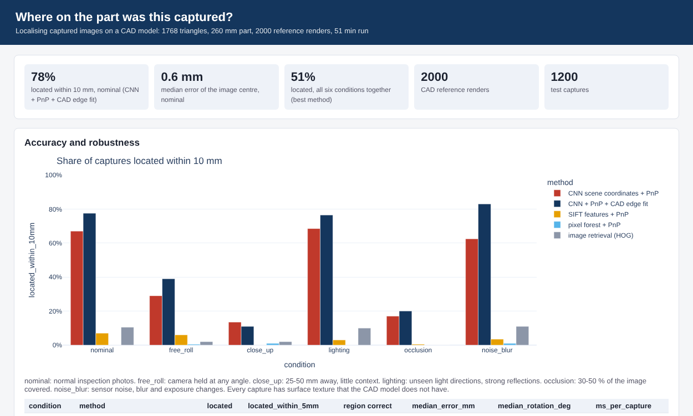
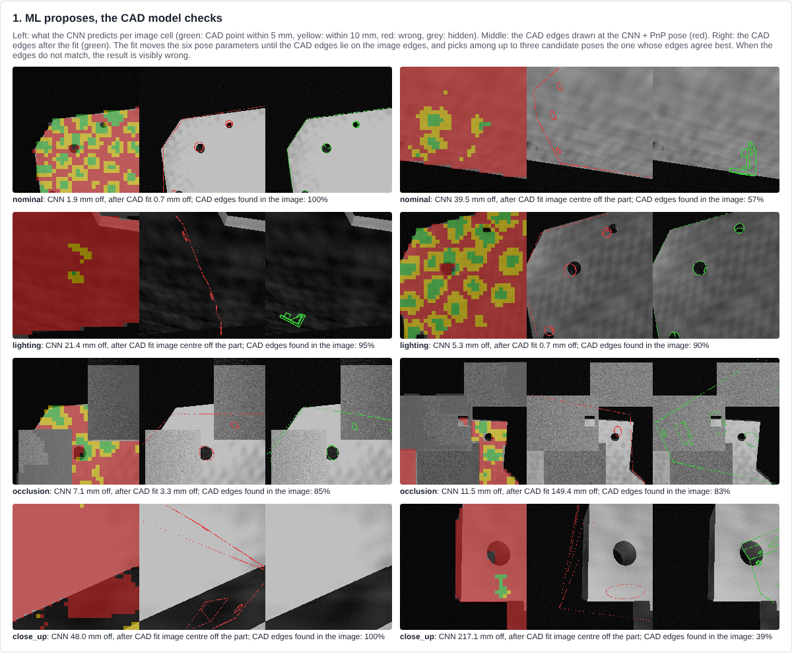
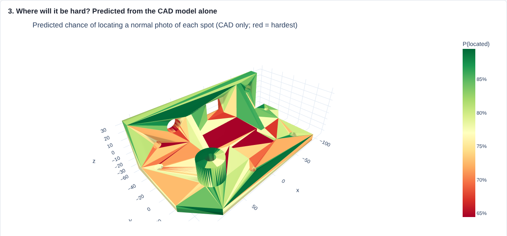

# Where on the part was this captured?

Images, measurements and scans are taken from aerospace components all through their life, but they are rarely
linked to an exact place on the component. This project is a proof of concept that finds where an image was captured
on a component and attaches it to the right point and region of the CAD model, using only the CAD model for training.

```
CAD model -> renders with known pose -> CNN predicts the CAD point behind each image cell -> PnP + RANSAC -> candidate poses
          -> CAD edge fit: adjust the 6 pose parameters until the CAD edges lie on the image edges, keep the best candidate
          -> point and region on the CAD model, with a calibrated probability of being right -> traceability table + dashboard
```

The machine learning part is kept small and the rest is geometry with a clear meaning: **ML proposes, the CAD model
checks.** Every stage is tested on its own, the confidence is calibrated on separate captures, and the CAD model alone
predicts where localisation will be hard. This follows the grey-box approach of system identification: a physical
model with interpretable parameters, fitted to the data, verified stage by stage and validated on held-out data.



## Research questions

1. Which approach places a captured image on the CAD model most reliably: image retrieval, local features, per-pixel
   machine learning, or a CNN that sees the whole image?
2. How do limited visual context (close-ups), lighting, partial visibility, noise and an unknown camera angle affect
   accuracy?
3. Can a model trained only on CAD renders work on images with surface texture the CAD model does not have?
4. Can the system tell when it is unsure, so that confident results are stored automatically and the rest go to a
   person? Does its probability of being right hold on new captures?
5. When it fails, which stage fails: the network, RANSAC or the geometry?
6. Can the CAD model alone predict where on the part localisation will be hard?
7. Does it generalise to captures outside the training range (distance, lens, texture)?

## Method

**Component.** A 260 mm machined bracket (plate, flange, ribs, boss, pocket, holes; 1 768 triangles), split into 12
surface regions. It has large plain surfaces and repeated features, which is what makes localisation hard. Any
STL/OBJ in millimetres can be used instead (`part.mesh` in `config.yaml`).

**Captures.** A ray-casting renderer (Open3D) gives a grey-scale image and the true CAD point behind every pixel. Test
captures look at a random spot on the part from 25 to 180 mm and get random surface texture that the CAD model does
not have, so the methods cannot match texture: they must use geometry, as with a real part. Six conditions:

| condition | what changes |
|---|---|
| nominal | normal inspection photo, camera roughly upright (within 20 degrees, as a gravity sensor gives) |
| free_roll | camera held at any angle |
| close_up | 25 to 50 mm away: little visual context |
| lighting | light from unseen directions, strong reflections |
| occlusion | 30 to 50 % of the image covered by clutter |
| noise_blur | sensor noise, blur and exposure changes |

**Methods.** All use only renders of the CAD model.

| method | how |
|---|---|
| image retrieval | HOG descriptor, pose of the most similar of 2 000 reference renders |
| SIFT + PnP | keypoints matched to keypoints of all reference renders (each with a 3D point), PnP + RANSAC |
| pixel forest + PnP | random forest predicts the CAD point of each pixel from its neighbourhood (after Shotton et al. 2013) |
| CNN + PnP | encoder-decoder predicts, for each 6 x 6 pixel cell, which of 64 surface patches it shows and the offset inside it (hierarchical scene coordinates, after Li et al. 2020), then PnP + RANSAC |
| CNN + PnP + CAD edge fit | the CNN + PnP gives up to three candidate poses (RANSAC again on the cells the earlier candidates did not explain); for each, the six pose parameters are fitted by robust least squares so that the visible CAD edges (sharp edges and silhouettes) fall on the image edges (after Drummond and Cipolla 2002); the candidate whose CAD edges agree best with the image wins |

The CNN is trained on 3 000 CAD renders with random texture, lighting, noise, blur and occluders (domain
randomisation), 25 epochs. Output: camera pose, the CAD point and region at the image centre, and a probability of
being right (calibrated from the RANSAC inliers and the CAD edge agreement).

## Results

1 200 test captures, 200 per condition. A capture counts as located when its image centre lands within 10 mm of the
true point on the 260 mm part.

| condition | CNN + CAD fit | CNN | SIFT | forest | retrieval | CNN + CAD fit within 5 mm | region correct | median error: CNN + CAD fit / CNN |
|---|---|---|---|---|---|---|---|---|
| nominal | **78 %** | 67 % | 7 % | 0 % | 10 % | 72 % | 83 % | **0.6 mm** / 5.1 mm |
| lighting | **77 %** | 69 % | 3 % | 0 % | 10 % | 74 % | 84 % | **0.7 mm** / 4.9 mm |
| noise_blur | **83 %** | 62 % | 4 % | 1 % | 11 % | 77 % | 84 % | **0.7 mm** / 5.8 mm |
| free_roll | **39 %** | 29 % | 6 % | 0 % | 2 % | 33 % | 45 % | 8 mm / 21 mm |
| occlusion | **20 %** | 17 % | 0 % | 0 % | 0 % | 15 % | 39 % | 31 mm / 31 mm |
| close_up | 11 % | **14 %** | 0 % | 1 % | 2 % | 6 % | 18 % | 37 mm / 34 mm |

All six conditions together: 51 % located with the CAD fit, 43 % with the CNN alone. The CAD fit also brings the
median camera rotation error in normal captures from 18 to 1.6 degrees. About 80 ms per capture for the CNN and
0.6 s with the CAD fit (three candidates) on a 2-core CPU. Every run gives the same numbers (seeded sampling and
RANSAC).

### What this shows

1. **Whole-image context is needed.** The per-pixel forest and retrieval are close to chance: a small patch of a plain
   machined surface looks like many other places. The CNN, which sees the whole image, locates 67 % of normal
   captures within 10 mm.
2. **Texture does not transfer, geometry does.** SIFT is precise when it succeeds (median 1.3 mm in normal captures) but
   locates at most 7 % of them, because real texture is not in the CAD model. Training the CNN with random texture
   made it rely on geometry.
3. **The CAD model makes the ML answer precise and checkable.** Fitting the pose to the CAD edges turns a 5 mm answer
   into a sub-millimetre one (72 % within 5 mm instead of 47 %), and choosing among candidate poses by the CAD edges
   fixes many cases where RANSAC picked a look-alike place (nominal 67 % to 78 %, noise and blur 62 % to 83 %).
4. **The limits are clear.** Close-ups with little context (11-14 %), heavy occlusion (20 %) and an unknown camera
   angle (39 %) are where the method breaks down. In close-ups there are too few CAD edges in view for the fit, which
   then does slightly worse than the CNN alone. Ways forward: a gravity sensor for the camera angle, a sequence of
   images instead of one, more training, or a pretrained backbone.

## Predictable and interpretable

The analyses below run as part of `cadloc run` and fill sections 1-5 of the dashboard.

### 1. ML proposes, the CAD model checks

For each capture the dashboard shows what the CNN predicts per image cell (right or wrong CAD point), the CAD edges
drawn at the CNN pose, and the CAD edges after the fit. The fitted parameters are the camera position (mm) and
orientation (degrees); the fit residual, the share of CAD edges found in the image, is a physical check that does not
depend on the network. When the edges do not line up, the result is visibly wrong.



### 2. Error budget: which stage causes the misses?

Each stage is tested on its own (`error_budget.csv`, CNN + PnP without the CAD fit):

| | nominal | lighting | noise_blur | free_roll | occlusion | close_up |
|---|---|---|---|---|---|---|
| cells with the right CAD point (within 10 mm) | 39 % | 39 % | 38 % | 16 % | 20 % | 13 % |
| located with the true CAD points of the same cells (PnP limit) | 98 % | 99 % | 99 % | 98 % | 100 % | 98 % |
| located with the correct cells only | 89 % | 90 % | 89 % | 57 % | 40 % | 28 % |
| located by the full pipeline | 67 % | 69 % | 62 % | 29 % | 17 % | 14 % |
| miss: too few correct cells (CNN did not recognise the view) | 10 % | 9 % | 8 % | 42 % | 58 % | 64 % |
| miss: wrong cells agreed on a look-alike place (RANSAC) | 14 % | 13 % | 22 % | 26 % | 20 % | 18 % |
| miss: cells mostly right, pose still imprecise | 9 % | 10 % | 7 % | 4 % | 6 % | 4 % |

PnP and the geometry are not the limit (98-100 %). In normal captures the correct cells alone would locate 89 %, so
most misses come from wrong cells outvoting right ones; the CAD check targets exactly that. In close-ups, occlusion
and free roll the network itself does not recognise the view, so the next step there is better learning, not better
geometry. Inside the network, 60 % of the cells get the right surface patch in normal captures, and the offset inside
the patch is off by about 8.5 mm (median): the classification step is the weaker one.

### 3. Where will it be hard? Predicted from the CAD model alone

Four numbers per view come from the CAD model only: CAD edges in view, surface orientations in view, how much of the
image the part fills, and whether a look-alike place exists elsewhere on the part. A logistic model fitted on the
calibration captures turns them into a chance of success and colours the CAD model with it (`localisability_map.csv`).

- It ranks located above missed test captures with AUC 0.65 (0.5 = chance): a moderate, honest predictor.
- Per surface region, the CAD-only map and the observed success correlate with r = 0.63.
- Effects match intuition: more CAD edges (+0.23 per standard deviation) and more surface orientations (+0.29) help;
  a look-alike place elsewhere on the part (-0.49) and a large plain surface filling the image (-0.31) hurt.

This tells, before any photo is taken, which areas of a component need extra views or another sensor: on the bracket,
the plain pocket floor and the flat plate areas are the hardest, the boss, the flange and the rib edges the easiest.



### 4. Held-out validation

The CNN and the fit were evaluated on data they were not tuned on (`heldout.csv`; 200 captures per set):

| set | inside the training range? | CNN + CAD fit | CNN |
|---|---|---|---|
| training images (seen) | yes | 62 % | 55 % |
| new images, training settings (unseen) | yes | 66 % | 60 % |
| test: nominal | yes | 78 % | 67 % |
| farther away (200-300 mm; training up to 200) | no | 85 % | 66 % |
| wide lens (65 degrees; training 50) | no | 88 % | 73 % |
| narrow lens (35 degrees) | no | 52 % | 51 % |
| stronger surface texture (0.10-0.15; training up to 0.08) | no | 60 % | 64 % |

Seen and unseen training-style images score the same, so the network learnt the part, not its training images (both
are lower than nominal because the training settings include close-ups from 25 mm). Farther views and a wider lens
work well, because more of the part is in view. A narrower lens (less context) and much stronger texture are harder.

### 5. A confidence you can trust

A logistic model turns the RANSAC inliers and the CAD edge agreement into a probability of being within 10 mm. It is
fitted on 900 separate calibration captures (new seeds) and checked on the 1 200 test captures:

| signals | calibration error (ECE) | Brier score | AUC |
|---|---|---|---|
| inliers + CAD fit | **0.030** | **0.114** | **0.914** |
| inliers only | 0.039 | 0.122 | 0.908 |

When it says 90 % or more, 96 % of those results are right:

| store automatically if the probability is at least | share of captures stored | of which located |
|---|---|---|
| 0.5 | 48 % | 87 % |
| 0.8 | 33 % | 94 % |
| 0.9 | 22 % | 96 % |

So a system can store the confident results with a known error rate and send the rest to a person.

## How to run

Python 3.11 or 3.12.

```bash
python -m venv .venv
.venv\Scripts\activate             # Windows; on Linux/macOS: source .venv/bin/activate
pip install -e .
cadloc run                         # uses the trained model in models/cnn.pt, about 50 minutes on a 2-core CPU
cadloc run --retrain               # train the CNN again (adds about 1 hour on a CPU, a few minutes on a GPU)
cadloc run --quick                 # small sizes, to try it out in a few minutes
cadloc run --resume                # after a restart: reuse the stages already finished in results/
```

**Google Colab (GPU):** open [`colab_train.ipynb`](colab_train.ipynb) in Colab
(Runtime > Change runtime type > T4 GPU) and run all cells. It trains a bigger CNN (`config_colab.yaml`: 12 000
training renders, 40 epochs) on the same test captures and saves it as `models/cnn_colab.pt`, so the CPU model and
its results stay for comparison. The GPU speeds up the training; the CAD fit and the analyses run on the CPU and take
about another hour.

```python
!git clone https://github.com/suka1901/cad_localization
%cd cad_localization
!pip install -q -e .
!cadloc run --config config_colab.yaml --retrain --out results_colab
```

To use your own component, set `part.mesh` to an STL/OBJ in millimetres and run `cadloc run --retrain`.

Output in `results/`:

| file | what |
|---|---|
| `dashboard.html` | accuracy per condition and method, captures on the 3D CAD model, CAD fit examples, error budget, CAD-only map, held-out and calibration |
| `captures.csv` | traceability table: one row per capture and method, with estimated CAD point, region, confidence, CAD edge agreement, probability of being right (`p_located`) and error |
| `summary.csv` | the results table above |
| `error_budget.csv`, `error_budget_summary.csv` | per capture and per condition: cell accuracy, stage tests, cause of each miss |
| `calibration_captures.csv`, `calibration_reliability.csv` | the separate calibration captures and the reliability table |
| `localisability_map.csv`, `localisability_regions.csv` | CAD-only predicted difficulty per surface spot and per region |
| `heldout.csv`, `heldout_runs/` | seen, unseen and out-of-range results |
| `analysis.json`, `run_info.json` | calibration and localisability scores; settings, run time and CNN training curve |

## Tests

```bash
pip install -r requirements-dev.txt
pytest            # 14 tests: geometry, rendering, PnP, conditions, repeatability, evaluation, a CNN training step,
                  # CAD edge fit, error budget, calibration, localisability features, out-of-range sets
pyright
```

## Layout

```
src/cadloc/
  part.py       CAD part (built-in bracket or your mesh) and surface regions
  render.py     ray-cast renderer: image plus the true CAD point of every pixel; camera sampling
  data.py       reference renders and test conditions
  methods.py    retrieval, SIFT + PnP, pixel forest + PnP
  cnn.py        CNN scene coordinates (patch classification + offset), domain randomisation, training
  fit.py        CAD edge model and the pose fit (ML proposes, the CAD model checks)
  evaluate.py   errors against the true pose and point
  diagnose.py   error budget: each stage tested on its own, cause of each miss
  calibration.py  probability of being right, reliability, ECE, Brier, accept rule
  localisability.py  CAD-only view features, difficulty model and surface map
  validation.py out-of-range capture sets
  analysis.py   runs the four analyses
  report.py     HTML dashboard
  cli.py        cadloc run
config.yaml     all settings
models/cnn.pt   trained CNN
```

## Limits

- Synthetic captures: rendered images with simulated texture, light and clutter, not photos of a real part. The next
  step is to validate on real photos with a known pose (for example from a robot or a tracked camera).
- One component. A model is trained per component, from its CAD model only.
- Single images. Close-ups would profit from a short image sequence or a depth sensor.
- The CAD fit needs CAD edges in view; with few edges (close-ups) it can drift, and its 0.6 s per capture is on a
  CPU without optimisation.
- The CAD-only difficulty map is a moderate predictor (AUC 0.65); it shows where to expect trouble, not a guarantee.

## References

- J. Shotton et al., Scene Coordinate Regression Forests for Camera Relocalization in RGB-D Images, CVPR 2013.
- X. Li et al., Hierarchical Scene Coordinate Classification and Regression for Visual Localization, CVPR 2020.
- J. Tobin et al., Domain Randomization for Transferring Deep Neural Networks from Simulation to the Real World, IROS 2017.
- T. Drummond and R. Cipolla, Real-Time Visual Tracking of Complex Structures, IEEE TPAMI 2002.
- V. Lepetit, F. Moreno-Noguer and P. Fua, EPnP: An Accurate O(n) Solution to the PnP Problem, IJCV 2009.
- M. Fischler and R. Bolles, Random Sample Consensus, Communications of the ACM 1981.
- C. Guo et al., On Calibration of Modern Neural Networks, ICML 2017.
