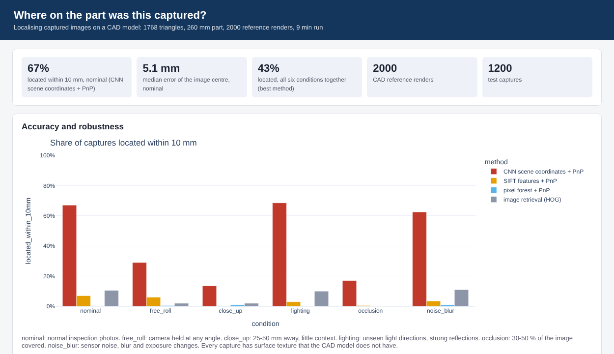

# Where on the part was this captured?

Images, measurements and scans are taken from aerospace components all through their life, but they are rarely
linked to an exact place on the component. This project is a proof of concept that finds where an image was captured
on a component and attaches it to the right point and region of the CAD model, using only the CAD model for training.

```
CAD model -> renders with known pose -> CNN predicts the CAD point behind each image cell -> PnP + RANSAC -> camera pose
          -> point and region on the CAD model, with a confidence -> traceability table + 3D dashboard
```



## Research questions

1. Which approach places a captured image on the CAD model most reliably: image retrieval, local features, per-pixel
   machine learning, or a CNN that sees the whole image?
2. How do limited visual context (close-ups), lighting, partial visibility, noise and an unknown camera angle affect
   accuracy?
3. Can a model trained only on CAD renders work on images with surface texture the CAD model does not have?
4. Can the system tell when it is unsure, so that confident results are stored automatically and the rest go to a
   person?

## Method

**Component.** A 260 mm machined bracket (plate, flange, ribs, boss, pocket, holes; 1 768 triangles), split into 12
surface regions. It has large plain surfaces and repeated features, which is what makes localisation hard. Any
STL/OBJ in millimetres can be used instead (`part.mesh` in `config.yaml`).

**Captures.** A ray-casting renderer (Open3D) gives a grey-scale image and the true CAD point behind every pixel. Test
captures look at a random spot on the part from 25 to 180 mm and get random surface texture that the CAD model does
not have, so the methods cannot match texture: they must use geometry, as with a real part. Six conditions:

| condition | what changes |
|---|---|
| nominal | normal inspection photo, camera roughly upright (within 20 degrees, as a gravity sensor gives) |
| free_roll | camera held at any angle |
| close_up | 25 to 50 mm away: little visual context |
| lighting | light from unseen directions, strong reflections |
| occlusion | 30 to 50 % of the image covered by clutter |
| noise_blur | sensor noise, blur and exposure changes |

**Methods.** All four use only renders of the CAD model.

| method | how |
|---|---|
| image retrieval | HOG descriptor, pose of the most similar of 2 000 reference renders |
| SIFT + PnP | keypoints matched to keypoints of all reference renders (each with a 3D point), PnP + RANSAC |
| pixel forest + PnP | random forest predicts the CAD point of each pixel from its neighbourhood (after Shotton et al. 2013) |
| CNN + PnP | encoder-decoder predicts, for each 6 x 6 pixel cell, which of 64 surface patches it shows and the offset inside it (hierarchical scene coordinates, after Li et al. 2020), then PnP + RANSAC |

The CNN is trained on 3 000 CAD renders with random texture, lighting, noise, blur and occluders (domain
randomisation), 25 epochs. Output: camera pose, the CAD point and region at the image centre, and a confidence
(RANSAC inliers).

## Results

1 200 test captures, 200 per condition. A capture counts as located when its image centre lands within 10 mm of the
true point on the 260 mm part.

| condition | CNN | SIFT | forest | retrieval | CNN within 5 mm | CNN region correct | CNN median error |
|---|---|---|---|---|---|---|---|
| nominal | **67 %** | 7 % | 0 % | 11 % | 47 % | 74 % | 5.1 mm |
| lighting | **69 %** | 3 % | 0 % | 10 % | 50 % | 75 % | 4.9 mm |
| noise_blur | **63 %** | 4 % | 1 % | 11 % | 38 % | 71 % | 5.8 mm |
| free_roll | **29 %** | 6 % | 1 % | 2 % | 16 % | 46 % | 21 mm |
| occlusion | **17 %** | 1 % | 0 % | 0 % | 9 % | 38 % | 31 mm |
| close_up | **14 %** | 0 % | 1 % | 2 % | 6 % | 32 % | 34 mm |

Confidence (CNN, all six conditions together):

| accepted | share of captures | located within 10 mm |
|---|---|---|
| all | 100 % | 43 % |
| most confident half | 50 % | 74 % |
| most confident quarter | 25 % | 87 % |
| 80 or more RANSAC inliers | 21 % | 87 % |

About 80 ms per capture on a 2-core CPU. Every run gives the same numbers (seeded sampling and RANSAC).

### What this shows

1. **Whole-image context is needed.** The per-pixel forest and retrieval are close to chance: a small patch of a plain
   machined surface looks like many other places. The CNN, which sees the whole image, locates 67 % of normal
   captures within 10 mm (median 5.1 mm).
2. **Texture does not transfer, geometry does.** SIFT is precise when it succeeds (median 2.5 mm) but finds a pose in
   only 5 % of captures, because real texture is not in the CAD model. Training the CNN with random texture made it
   rely on geometry, and it holds up under new lighting (69 %) and noise (63 %).
3. **The limits are clear.** Close-ups with little context (14 %), heavy occlusion (17 %) and an unknown camera angle
   (29 %) are where the method breaks down. Ways forward: a gravity sensor for the camera angle, a sequence of images
   instead of one, more training, or a pretrained backbone.
4. **Confidence makes it usable.** The quarter of captures with the highest confidence are 87 % correct, so a system
   can store those automatically and ask a person about the rest.

## How to run

Python 3.11 or 3.12.

```bash
python -m venv .venv
.venv\Scripts\activate             # Windows; on Linux/macOS: source .venv/bin/activate
pip install -e .
cadloc run                         # uses the trained model in models/cnn.pt, about 10-20 minutes on a CPU
cadloc run --retrain               # train the CNN again (about 1 hour on a CPU, a few minutes on a GPU)
cadloc run --quick                 # small sizes, to try it out in a few minutes
```

**Google Colab (GPU):**

```python
!git clone https://github.com/suka1901/cad_localization
%cd cad_localization
!pip install -q -e .
!cadloc run --retrain
```

To use your own component, set `part.mesh` to an STL/OBJ in millimetres and run `cadloc run --retrain`.

Output in `results/`:

| file | what |
|---|---|
| `dashboard.html` | accuracy per condition and method, captures on the 3D CAD model, confidence curve, examples |
| `captures.csv` | traceability table: one row per capture and method, with estimated CAD point, region, confidence and error |
| `summary.csv` | the results table above |
| `run_info.json` | settings, run time and CNN training curve |

## Tests

```bash
pip install -r requirements-dev.txt
pytest            # 9 tests: geometry, rendering, PnP, conditions, repeatability, evaluation, a CNN training step
pyright
```

## Layout

```
src/cadloc/
  part.py       CAD part (built-in bracket or your mesh) and surface regions
  render.py     ray-cast renderer: image plus the true CAD point of every pixel; camera sampling
  data.py       reference renders and test conditions
  methods.py    retrieval, SIFT + PnP, pixel forest + PnP
  cnn.py        CNN scene coordinates (patch classification + offset), domain randomisation, training
  evaluate.py   errors against the true pose and point
  report.py     HTML dashboard
  cli.py        cadloc run
config.yaml     all settings
models/cnn.pt   trained CNN
```

## Limits

- Synthetic captures: rendered images with simulated texture, light and clutter, not photos of a real part. The next
  step is to validate on real photos with a known pose (for example from a robot or a tracked camera).
- One component. A model is trained per component, from its CAD model only.
- Single images. Close-ups would profit from a short image sequence or a depth sensor.

## References

- J. Shotton et al., Scene Coordinate Regression Forests for Camera Relocalization in RGB-D Images, CVPR 2013.
- X. Li et al., Hierarchical Scene Coordinate Classification and Regression for Visual Localization, CVPR 2020.
- J. Tobin et al., Domain Randomization for Transferring Deep Neural Networks from Simulation to the Real World, IROS 2017.
